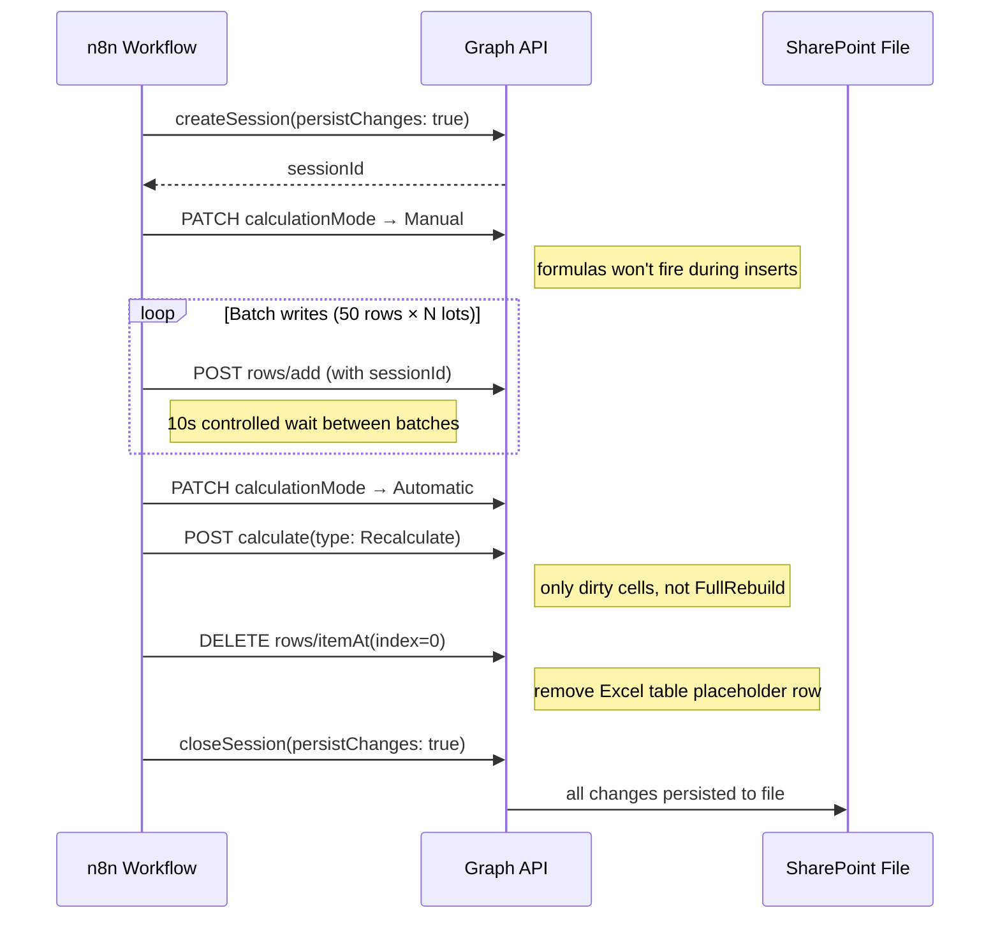
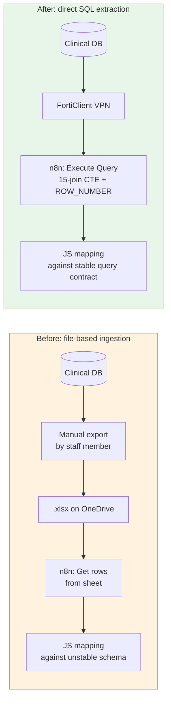
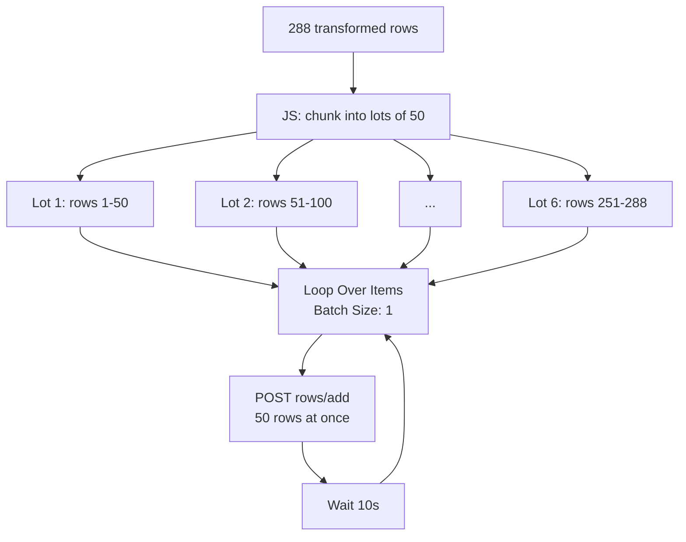

# Engineering a Regulatory Compliance Pipeline Over an Undocumented Clinical Database

## Why this exists

Every month, a regional university hospital in Colombia has to report patient appointment wait times to the national health regulator, under Resolución 1552 de 2013. The report tracks how long patients wait between requesting a specialist appointment and actually getting seen, broken down by 25 medical specialties, each with its own regulatory cap: 3 calendar days for general medicine, 7 for most specialists, 15 for subspecialties like endocrinology or rheumatology. If the numbers are wrong or the report is late, that is a compliance problem for the hospital, not an abstract one.

Before this project, an administrative staff member did this by hand every month: pull a spreadsheet export from the clinical system, manually filter and map columns into the official template, calculate date differences by hand or with brittle formulas, and email the result. The process took roughly 70 minutes per run and, because it depended on manual transcription, it also introduced errors: a specialty typed slightly differently, a date pasted into the wrong column, a formula that silently broke when someone inserted a row. I timed the manual process end to end before starting.

I worked on this as part of a two-person engineering team during a university-industry immersion at the hospital's IT department. The project was advised by a PhD researcher in AI who reviewed the architecture decisions, and I worked daily alongside a cybersecurity specialist (who managed Azure AD app registrations and OAuth2 credential provisioning) and a database engineer (who helped me navigate the undocumented clinical schema and co-authored the extraction query). I participated in weekly IT team standups via Microsoft Teams, where I reported pipeline status and coordinated access requirements.

We automated the full pipeline with n8n (self-hosted via Docker Compose on WSL2, backed by PostgreSQL): a direct extraction from the hospital's clinical SQL Server database over VPN, transformation into the regulatory format, a batch write into the official Excel template hosted on SharePoint via Microsoft Graph API, distribution by email through Outlook, and structured failure alerting back into the hospital's own incident tracking system. The automated version runs in about 6 minutes, with zero manual transcription.

None of that sounds hard on paper. In practice, almost every step surfaced a failure mode that does not show up until you are staring at an Excel sheet full of zeros wondering why a formula that is obviously correct is returning nothing. This document is about those failures: what I saw, how I figured out what was actually happening instead of guessing, what I tried and discarded, and what I'd do differently with more time.

## Architecture overview

The pipeline has five stages, orchestrated as a 30-node n8n workflow that fires on the 7th of each month at midnight (Colombia timezone):

```mermaid
flowchart LR
    subgraph Extraction
        T[Schedule Trigger\nDay 7, midnight] --> SQL[(Clinical\nSQL Server\n15-join CTE)]
    end

    subgraph Transformation
        SQL --> JS[JS Mapping\nlocale handling\ndate serialization\nspecialty filter]
    end

    subgraph File_Preparation
        T --> Search[Search template\nin SharePoint] --> Copy[Copy .xlsm\nmonth-stamped name]
        Copy --> Wait90[Wait 90s\nSharePoint indexing]
        Wait90 --> Search2[Search copy\nby driveItem ID]
    end

    subgraph Load
        JS --> Merge{Merge\nsync branches}
        Search2 --> Merge
        Merge --> Batch[Batch into\n50-row lots]
        Batch --> Session[createSession\npersistChanges: true]
        Session --> ManualCalc[PATCH\ncalcMode: Manual]
        ManualCalc --> Loop[Loop Over Items\n+ 10s wait per batch]
        Loop --> AutoCalc[PATCH\ncalcMode: Automatic]
        AutoCalc --> Recalc[POST\ncalcType: Recalculate]
        Recalc --> DelRow[DELETE\nplaceholder row 0]
        DelRow --> Close[closeSession\npersistChanges: true]
    end

    subgraph Distribution
        Close --> DL[Download\ncompleted file] --> Email[Outlook\nHTML + attachment]
        Email --> Wait10[Wait 10s] --> DelFile[DELETE\ntemp copy from Drive]
        DelFile --> Success[SQL INSERT\nsuccess alert]
    end

    SQL -. error .-> AlertSQL[SQL alert:\ntable access failure]
    Search -. error .-> AlertFile[SQL alert:\ntemplate not found]
    Copy -. error .-> AlertCopy[SQL alert:\nduplicate / quota / access]
    Email -. error .-> AlertMail[SQL alert:\nOutlook auth revoked]

    style AlertSQL fill:#fee,stroke:#c33
    style AlertFile fill:#fee,stroke:#c33
    style AlertCopy fill:#fee,stroke:#c33
    style AlertMail fill:#fee,stroke:#c33
```

1. **Extraction**: a Microsoft SQL node runs a CTE-based query directly against the hospital's clinical database over VPN (FortiClient Zero Trust), joining across patient demographics, appointment history, medical folios, specialty catalogs, diagnosis tables, and insurance-contract records (15 JOINs total: 9 INNER, 4 LEFT, 2 OUTER APPLY). The query filters by date range, appointment status, specialty whitelist, and insurer; deduplicates using `ROW_NUMBER() OVER (PARTITION BY ...)` to collapse duplicate folio entries down to the most recent one per patient/specialty/appointment; and pushes specialty-mapping logic and day-count math (`DATEDIFF`) into the query itself via `CASE` expressions.

2. **Transformation**: a JavaScript node maps the raw SQL output into the exact column structure of the regulatory template (30 columns). This includes translating month names from the SQL Server's English locale to Spanish, normalizing specialty strings to uppercase for formula compatibility, converting ISO timestamps to Excel serial dates with `Math.floor()` to strip the time-of-day fraction, casting long numeric codes to strings to prevent scientific notation in Excel, and filtering rows to the 25 specialties the regulatory template tracks.

3. **Load**: the transformed rows are chunked into fixed-size lots of 50 rows each, then written one lot at a time into a fresh monthly copy of the official `.xlsm` template via the Microsoft Graph API's workbook session endpoints. The session lifecycle is explicit: create a persistent session, toggle calculation mode to Manual (to prevent formula recalculation on every insert), loop the batch writes with a 10-second controlled wait between iterations, toggle back to Automatic, issue a scoped `Recalculate` (dirty-cell only, not FullRebuild), delete the placeholder row that Excel's table structure leaves behind, and close the session with `persistChanges: true`. This triggers downstream formulas on a second sheet (`Indicadores`) that calculate the regulatory indicators (totals, averages, max/min wait per specialty) off the raw data sheet. All HTTP calls to Graph API reuse the same OAuth2 credential because the workbook session is bound to that token: a different credential would orphan the session.

4. **Distribution**: the completed file is downloaded from SharePoint, attached to an HTML email built with the hospital's branded signature block (logo, contact information, legal disclaimer), and sent through Outlook. Since Graph API bypasses the Outlook client entirely, the email body must include the institutional signature as inline HTML: the server-side API has no knowledge of signatures configured in a local Outlook profile. After successful delivery, the temporary copy is deleted from OneDrive to avoid accumulation, and a success-confirmation row is written to the hospital's incident table.

5. **Alerting**: every externally-dependent node is configured with `On Error: Continue (using error output)`, routing failures into conditional branches that classify the failure type (database access error, template not found, duplicate filename, quota exceeded, access denied, OAuth token expired) and write a timestamped, human-readable alert row into the hospital's own incident-tracking table (`DnHistorialSs_new`), so a silent monthly automation failure becomes a logged, actionable event instead of a missed report nobody notices until someone asks for it.

The rest of this document walks through six problems from that pipeline that I think are the most revealing, not because they were the hardest to fix mechanically, but because each one taught me something about how cloud productivity APIs fail: usually without an exception, usually without a log entry, and usually in a way that looks exactly like "my formula is wrong" until you prove otherwise.

---

## Problem 1: the session that quietly threw away every write

**Symptom.** The workflow ran end to end with no errors in any node. Every HTTP call returned 200. The loop that appended rows completed all its iterations. And when I opened the resulting file, the data sheet was empty.

This is the failure mode that worries me the most, in general: a fully "successful" execution that did nothing. There was no stack trace to read, no node turning red, nothing in the n8n execution log pointing at the problem.

**Diagnosis.** I didn't catch this from an error message, because there wasn't one. I caught it by cross-referencing the live file against the row count I expected after a clean run: I knew how many patients should be in the output, and the file had zero. That mismatch was the only signal. From there I walked backward through the session lifecycle: create session, batch inserts, calculation mode toggles, close session; and checked the body of each call against what I'd actually written, instead of assuming the close-session call was fine just because it returned 200.

That's where I found it: `{ "persistChanges": false }` on the session close. Every batch-inserted row had been written to the in-memory Graph API session correctly; the close call then discarded all of it on session teardown, by design, because that's literally what `persistChanges: false` means. The API did exactly what I told it to do. The workbook looked untouched not because the write failed, but because I'd told the session not to keep anything.

**Alternatives considered.** There wasn't really an alternative implementation here; it was a one-line configuration bug. The more interesting decision was methodological: whether to assume the data pipeline itself was broken (wrong SQL, wrong mapping, wrong column indices) or to assume the write-path plumbing was broken. Given that the appends had each individually returned successful responses with correct row data in their payloads, I ruled out the transformation logic first and focused on the session lifecycle instead of re-debugging the JavaScript mapping from scratch.

**Solution.** Set `persistChanges: true` on session close. That's it. The fix is trivial; the lesson is not.

**What I'd do differently.** A successful HTTP response from an API that operates on a session is not evidence the operation was durable. Anywhere a system separates "the operation succeeded" from "the operation was persisted," I now explicitly verify the persisted state, not just the response code, before considering a step done. For this pipeline specifically, that meant eventually adding a post-write row-count sanity check as its own step, rather than trusting the Loop Over Items completion as proof of anything.

---

## Problem 2: full recalculation vs. the API's patience

**Symptom.** After getting the writes to actually persist, I needed the workbook's formulas to pick up the new data. I used `calculationType: FullRebuild`, which rebuilds the entire dependency graph in the workbook. On a file with hundreds of rows, VBA macros, embedded logos, and cross-sheet formula chains between the raw data sheet and the indicators sheet, this consistently timed out with a 429: `MaxRequestPendingDurationExceeded`.

**Diagnosis.** This one was more straightforward to diagnose because the error message was explicit about the cause: the operation itself was taking too long, not that I was sending requests too fast. That distinction matters; a naive read of "too many requests" suggests throttling and backoff, but the actual issue was that `FullRebuild` is an expensive operation by nature on a workbook with many interdependent formulas, and Graph API has a pending-duration ceiling that a full dependency rebuild on a large `.xlsm` file can exceed on its own.

It's worth noting that the workbook's weight came from more than just rows: the `.xlsm` format carries VBA macros and embedded images (institutional logos stamped on the regulatory template), which the Graph API engine has to load into the session before it can process any formula evaluation. This made even the session creation noticeably slower than a plain `.xlsx` would have been.

**Alternatives considered.** The first instinct is to just retry with backoff, since that's the generic fix for anything that looks like a 429. I discarded that because retrying the exact same expensive operation doesn't fix anything if the operation itself is what's too slow; it just delays the same timeout. I also considered leaving the file in manual calculation mode and relying on the user opening it in Excel to trigger a recalculation, which technically works, but means the formulas are not guaranteed correct the moment the file is emailed: the recipient would open a report full of zeros until they manually pressed recalculate. Not acceptable for a compliance deliverable.

I also initially tried using n8n's built-in Google Sheets "Append rows to table" node instead of raw HTTP Request calls, but that gave me "Gateway timed out" errors on the same file, for the same root cause: the `.xlsm` workbook was too heavy for the default API timeout window. That's when I moved to raw HTTP Request nodes, which let me control the session lifecycle, calculation mode, and batch timing directly.

**Solution.** A two-step approach instead of one blunt instrument: first, toggle `calculationMode` back to `Automatic` via a PATCH to the workbook application settings; second, issue a scoped `calculationType: Recalculate`, which only recalculates cells that are actually marked dirty, instead of rebuilding every dependency in the workbook. This is substantially cheaper and stopped throwing 429s entirely, without sacrificing correctness, since every cell touched by the new data still gets recalculated.

**What I'd do differently.** I'd reach for the narrowest operation first next time, instead of the most thorough-sounding one. "Full rebuild" sounds like the safe, complete option, and that's exactly why I defaulted to it; in practice it's the expensive option, and `Recalculate` was sufficient because the only thing that changed was the data, not the formula structure itself.

The full session lifecycle, after fixing both the persistence bug (Problem 1) and the recalculation strategy:

---

## Problem 3: array formulas that only broke in one language

**Symptom.** Two columns on the indicators sheet: "maximum days of wait" and "minimum days of wait" per specialty, returned `#N/D` on every row, even once the underlying data columns were confirmed correct and non-zero.

**Diagnosis.** The formulas were legacy array formulas: `{=MAX(SI(range=criteria, range))}`, which in Excel desktop require `Ctrl+Shift+Enter` entry semantics to evaluate as an array instead of a scalar. Excel Online's calculation engine, invoked via Graph API, doesn't reliably honor that evaluation mode on recalculation. I confirmed the underlying data was fine first, with isolated `CONTAR.SI` test-cell formulas against known specialty values, before touching the MAX/MIN formulas at all; that ruled out "the data isn't there" before I started rewriting formulas.

The fix seemed obvious once I'd ruled out the data: replace the array formula with `MAXIFS`/`MINIFS`, which do the same conditional max/min without array-entry semantics. I rewrote the formulas, tested them, and got `#NOMBRE?` instead of a value, which in Excel means "function name not recognized."

That one took me a second to place, because the formula was syntactically correct. The workbook was running on a Spanish-locale build of Excel, and `MAXIFS`/`MINIFS` are the English function names; the Spanish-locale equivalents are `MAX.SI.CONJUNTO` and `MIN.SI.CONJUNTO`. Same function, different name, entirely locale-dependent, and nothing in the error message told me that directly; I only got there by testing the English name in isolation on an empty cell and seeing the exact same `#NOMBRE?` independent of any reference to real data, which pointed at the function name itself rather than anything about my formula's logic.

**Alternatives considered.** I could have kept the array formulas and tried to force array evaluation some other way through the API, but there's no clean way to do that through Graph API's calculation endpoints; array-entry semantics are fundamentally a client-side UI concept in older Excel, not something you can toggle server-side. Abandoning array formulas in favor of `*IFS` functions was the only path that didn't depend on fighting the calculation engine's locale and evaluation quirks directly.

**Solution.** Replace every `MAX(SI(...))`/`MIN(SI(...))` array formula with `MAX.SI.CONJUNTO`/`MIN.SI.CONJUNTO`, wrapped in `SI.ERROR(...; 0)` so a genuine no-match case returns 0 instead of propagating `#N/D` into totals further down the sheet.

**What I'd do differently.** When a formula error looks locale-agnostic (an array formula not evaluating, a function not recognized), I now test the smallest possible isolated case (a hardcoded value, an empty cell) before assuming the problem is in my data or my logic. The locale issue specifically is one I wouldn't have thought to check for if I hadn't already ruled out everything else first; it's not something that comes to mind by default when you're used to reading formulas in English documentation.

| Attempt | Formula | Result |
|---|---|---|
| Original array formula | `{=MAX(SI(range=criteria, range))}` | `#N/D` — array semantics not honored via Graph API |
| English function name | `=MAXIFS(range, criteria_range, criteria)` | `#NOMBRE?` — unrecognized on Spanish-locale workbook |
| Spanish-locale equivalent | `=MAX.SI.CONJUNTO(range, criteria_range, criteria)` | ✓ Correct |

---

## Problem 4: the one-row offset that zeroed out every indicator

**Symptom.** Every single indicator formula on the second sheet returned 0, across every specialty row, for every metric: total appointments, sum of wait days, average wait, max/min wait. Nothing computed. And the data sheet, visibly, had hundreds of correctly populated rows.

**Diagnosis.** The first hypothesis is always the cheap one: maybe the specialty name strings don't match exactly (trailing spaces, accents, case). I tested that directly with `LARGO()` (string length) and `IGUAL()` (exact string comparison) between a cell in the indicators sheet and a visually identical cell in the data sheet, and got a match. So the strings were fine.

The actual diagnostic step that found the bug was testing `CONTAR.SI` twice: once with a hardcoded literal value against the real range (`=CONTAR.SI(range, "CIRUGIA GENERAL")`), which returned a correct non-zero count; and once with a cell reference to the exact same value (`=CONTAR.SI(range, B6)`), which returned 0. Same criteria, same range, different result depending on whether the criteria came from a literal or a reference. That ruled out the data itself; the problem had to be in how the ranges were defined relative to each other.

Looking at the actual formula, the criteria range started at row 11 (`$Q$11:...`) while the paired sum/lookup range in another formula started at row 10 (`$S$10:...`). `SUMAR.SI`/`CONTAR.SI` map ranges to each other positionally, row by row; a one-row offset between two ranges that are supposed to represent the same set of records silently shifts every comparison by one row, and neither function throws an error for this. It just produces wrong (often zero) answers quietly.

**Alternatives considered.** None, really; this wasn't a design decision, it was a consistency bug introduced by two ranges being edited at different times without re-checking their alignment against each other. The only "alternative" worth mentioning is that I could have kept guessing at data issues (encoding, locale, special characters) instead of testing the hardcoded-vs-reference comparison, which would have wasted a lot more time chasing a problem that didn't exist.

**Solution.** Realign every range in every indicator formula so the start row (and the extent) is identical across all paired ranges in the same formula: same start row for the criteria range and the value range, consistently, across every column.

**What I'd do differently.** This is the kind of bug that spreadsheet-based data pipelines are especially prone to, precisely because nothing enforces range consistency across formulas the way a type system enforces array-length consistency in code. If I were designing this from scratch today, I'd push more of this aggregation logic into the SQL query itself (grouping and counting server-side) rather than relying on spreadsheet-native conditional functions over manually-maintained ranges, specifically because this class of bug doesn't exist in SQL the way it does in spreadsheet formulas.

---

## Problem 5: migrating off a file that shouldn't have existed

**Symptom.** This isn't a bug in the traditional sense; it's closer to a structural weakness I kept running into throughout the earlier version of the pipeline. The original design extracted data from a monthly `.xlsx` export that someone on the hospital's side generated from the clinical system and handed off as an intermediate file. Every month, this introduced a dependency on someone remembering to generate and place the export correctly, with whatever column naming or formatting drift that export happened to have that month.

**Diagnosis.** There wasn't a single incident that "diagnosed" this; it was more that every time I fixed a mapping bug, I was fixing it against the specific quirks of that month's manual export, not against a stable contract. That's a sign the actual root cause isn't in the code, it's in the architecture: a manual file hop as a single point of failure between the source of truth (the hospital's clinical database) and the automation.

**Alternatives considered.** I considered hardening the file-read step instead of removing it: stricter column validation, clearer error messages when a column was missing or renamed, maybe a schema check before processing. All of that would have reduced the blast radius of a bad export, but none of it addresses the actual failure mode, which is that a human has to correctly generate and place a file every month for the automation to even start.

**Solution.** The hospital's database team provided a fully deduplicated SQL query that extracts directly from the clinical SQL Server database. This required secure network access that I didn't initially have: the cybersecurity specialist configured a FortiClient VPN connection so I could reach the hospital's internal SQL Server from my development environment (n8n running on Docker/WSL2 at home), and the database engineer walked me through the undocumented schema, since there was no data dictionary or ERD available. Together we mapped the right tables and built the 15-join CTE with window-function deduplication (`ROW_NUMBER() OVER (PARTITION BY ...)` collapsing duplicate folio entries), with the specialty-mapping logic and day-count math already pushed down into the query itself via `CASE` expressions and `DATEDIFF`.

I replaced the file-read node entirely with a Microsoft SQL "Execute Query" node, collapsing a two-source, human-dependent pipeline into a single automated extraction with zero manual steps in between.

This did introduce new problems of its own, which is worth being honest about: the SQL output used different field names and different date formats (ISO timestamps like `2025-01-14T08:36:33.970Z` instead of Excel serial dates like `46065`) than the old Excel export did; the month name came back in English instead of Spanish because of the SQL Server's locale configuration; and several fields that the old mapping logic depended on (`PV_CONTROL`, `ESTADO_CITA`) simply didn't exist in the new source, because the SQL query had already filtered the dataset down to exactly the cases those fields used to distinguish. Each of these required a corresponding adaptation in the JavaScript transformation layer: a new `isoASerialExcel()` function with `Math.floor()` to strip time-of-day fractions, a month-name translation map, and hardcoded values for fields that the query's own filters already guaranteed.

**What I'd do differently.** I'd push for this change earlier. It's tempting to treat the manual file hop as "someone else's problem" since the automation itself worked around it, but every bug downstream of that file was, in some sense, downstream of a step that shouldn't have existed in an automated pipeline in the first place.

---

## Problem 6: keeping 500 rows under Graph API's patience

**Symptom.** Writing every row of a ~500+ row monthly dataset as a sequential single-row API call would have been slow and, more importantly, would have run into Graph API's request-rate throttling well before the dataset finished writing.

**Diagnosis.** This one didn't need much diagnosis in the sense of "something broke and I had to figure out why"; it was a design constraint I anticipated from the API's documented throttling behavior and from watching how quickly a 429 showed up once I started testing with even moderate batch sizes.

**Alternatives considered.** Pure retry-with-backoff on 429s was the obvious fallback, and it's still in place as a safety net (every HTTP Request node has `Retry On Fail` enabled with 3 attempts and 5-second waits), but relying on it as the primary strategy means accepting unpredictable run times and repeatedly hitting a rate limit I already know exists, instead of designing around it.

**Solution.** A two-tier batching strategy: on the client side, a JavaScript node chunks the full row set into fixed-size lots of 50 rows each; a `Loop Over Items` node then iterates over those lots one at a time (`Batch Size: 1`), with a controlled 10-second wait between each iteration, so the sustained request rate stays under the API's tolerance by design rather than by accident. The lot size itself was tuned down from an initial 50 to the current value after observing throttling behavior at larger sizes; this wasn't something I could calculate up front, since the actual threshold depends on current API load, workbook complexity, and whether the `.xlsm` file's VBA macros add processing overhead to each session operation.

**What I'd do differently.** I'd build in a feedback mechanism to adjust batch size dynamically based on observed response latency or early 429s during a run, rather than a fixed value I tuned once by hand. For a monthly, low-volume pipeline like this one, the fixed value is fine; for anything that needs to scale to a larger hospital network or a higher-frequency report, I wouldn't want to re-tune this by hand every time the data volume changes.

---

## Infrastructure: running n8n on Docker and losing everything once

The pipeline runs on a self-hosted n8n instance deployed via Docker Compose on WSL2, backed by PostgreSQL 15 for workflow and credential storage. I set the timezone to `America/Bogota` so the Schedule Trigger fires at the right local time, configured execution data to only persist on errors (to keep the database lean), and enabled task runners for performance.

Early in development, I ran `docker compose down -v`. The `-v` flag deletes named volumes. n8n stores its encryption key in a config file on one volume and all credentials in PostgreSQL on the other. Both volumes were wiped. When I brought the stack back up, Docker created fresh, empty volumes: new encryption key, empty database. The workflow JSON was safe (I'd exported it), but every OAuth2 credential: OneDrive, Outlook, Excel, and the SQL Server connection, was gone. I had to re-provision every credential with the cybersecurity specialist from scratch: new client secrets, new consent grants, new token exchanges through Azure AD.

The lesson was immediate: bind-mount the volumes to host directories instead of relying on Docker-managed named volumes, so the data survives even a careless `down -v`. The current `docker-compose.yml` uses `driver_opts: { type: none, o: bind, device: ./n8n_data }` for exactly this reason. It's the kind of mistake you only make once, but it costs real hours when the credentials you lost require another person (with Azure admin privileges) to re-issue.

---

## Impact and what I'd harden next

The practical result: a report that took roughly 70 minutes of manual work, with transcription-error risk at every hand-off, now runs in about 6 minutes end to end, with zero manual transcription between the clinical database and the final emailed report. The indicators sheet, which used to depend on someone correctly maintaining spreadsheet formulas across monthly copies of the template, now recalculates automatically against freshly written data every run.

The failure alerting system covers 7 classified failure modes, each writing a timestamped, human-readable row into the hospital's own incident-tracking table:

| Alert | Trigger |
|---|---|
| Database access failure | SQL extraction node returns an error |
| Template not found | Schema file missing or renamed in SharePoint |
| Duplicate filename | Monthly copy already exists |
| Storage quota exceeded | OneDrive storage full |
| Drive access denied | OAuth2 permissions revoked for OneDrive |
| Outlook auth expired | OAuth2 token for email delivery expired |
| Success confirmation | Full pipeline completed without errors |

If I had more time, there's a specific list of things I'd want to harden before calling this production-grade rather than production-functional:

- **Encryption at rest for the output file.** The report contains patient-identifiable data (name, ID number, phone, address); right now the only protection is SharePoint's default access controls, not file-level encryption.
- **A secure distribution channel instead of email.** Email, even internal, is not an ideal channel for a file containing patient data; a proper secure file-sharing mechanism with access logging would be a meaningful improvement over an attachment in an inbox.
- **A real secrets manager.** Credentials currently live inside n8n's credential store (encrypted with a key in the container's filesystem, which I learned the hard way can be lost); for a pipeline touching clinical data, I'd want those managed through a dedicated secrets manager with rotation policies, not just an encrypted-at-rest credential object inside the automation platform itself.
- **Least-privilege database access.** The SQL credential used for extraction has broader access than the query strictly requires; a read-only, scoped account against exactly the tables and views this query needs would reduce the blast radius if that credential were ever compromised.
- **Audit logging on the data path itself**, not just on failures. Right now, the alerting system tells us when something broke. It doesn't yet tell us who ran the workflow, when, with what row counts, as a durable audit trail independent of whether anything failed, which is the kind of thing a compliance-adjacent pipeline touching patient data probably should have from day one, not added after the fact.

None of these were urgent enough to block shipping something that cut a 70-minute manual process with real error risk down to 6 minutes with none, and I think that trade-off was the right one to make first. But they're the honest list of what separates "this reliably works" from "this is the kind of system I'd want handling patient data long-term without me checking on it."
